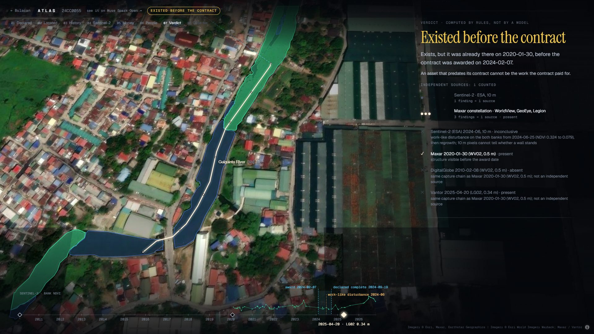

# Atlas

**Atlas checks what a government declared against what the Earth shows.**

Its first mission, Groundtruth, audits whether the flood-control works the Philippines paid for were built. Between
2022 and 2025 the government recorded 9,855 flood-control projects as complete, worth ₱547.6 billion. Inspectors later
called hundreds of them ghosts, and the President stood on a riverbank in Bulacan where ₱55.7 million had bought
nothing. Finding suspects was never the hard part. Proving each one took a team, a site visit and months, and the
hardest part was where: after checking more than 8,000 projects the public-works department listed 421 suspected
ghosts, then found that 337 of the 416 distinct ones exist at a different location from the one submitted ("the
location coordinates given to the validators were wrong"), and by January 2026 the Justice Department had confirmed 14
([SunStar, 19 Jan 2026](https://www.sunstar.com.ph/manila/doj-only-14-flood-projects-confirmed-ghosts-so-far)).

Atlas takes a province and a deadline, and sends a fleet of agents through every contract, most money and most red
flags first. Each agent tests one audit assertion against independent evidence: sub-metre satellite history, the
Sentinel-2 archive, street-level photos and the public record. Fixed rules, not a model, decide each outcome. Every
reading, mask and verdict is sealed in a hash-chained ledger, and a human investigator signs every case.

**Demo, no install:** https://marc-dvci.github.io/atlas-groundtruth/ (recorded runs; the browser re-verifies every
ledger hash itself). **Live audit:** https://rgt48790--atlas-live-web.us-east.modal.run (pick a Bulacan contract, or a random one, and watch Atlas audit it from
scratch). The case below: [24CC0055](https://marc-dvci.github.io/atlas-groundtruth/#/case/eval/24CC0055).



## What a case looks like

1. **Declared.** The contract's own words: "Construction of Riverbank Protection Structure at Barangay Bulihan, Malolos
   City", ₱77.2 million, declared complete on 19 April 2024.
2. **Located.** Published pins are unreliable: in Bulacan, 46 of the 918 contracts that name a barangay have a pin more
   than 1 km outside it, and four pins repeat their longitude's six decimals in the latitude. The Locator reads the
   description and works through map tools (official barangay boundaries, every mapped waterway, the other contracts
   that name the same barangay, and SAM 3.1 tracing a channel the map lacks) until it can cut the reach the text
   describes.
3. **History.** Every distinct sub-metre capture of the site since 2010 (Esri World Imagery Wayback). SAM 3.1 segments
   the hard banks and the water in each one; Muse Spark reads every capture along the reach, oldest first; Muse Spark
   Open re-reads every capture that could decide the case (all before the award, all after completion), each beside the
   last earlier capture from before the award, and a reading counts only when both models say the same thing. Wayback can list one image under several dates; identical pixels count once.
4. **Elsewhere.** When the declared reach is bare after completion, Atlas walks the same waterway 1.5 km each way,
   compares SAM 3.1 hard-bank masks before the award and after completion window by window, and asks Muse Spark to
   confirm the strongest candidate.
5. **Sentinel-2.** Every clear 10 m scene since four years before the award, bank by bank, compared season against
   season, to date when the bank changed.
6. **Money and people.** Bids at the ceiling, contracts paid twice for the same stations, every contract that names the
   same barangay, and the number of people who live within 1.5 km of the reach on ground no more than 3 m above its
   bank (Meta and CIESIN High Resolution Settlement Layer, Copernicus DEM).
7. **Verdict.** Computed by the rules below. Each source is listed as counted or refused, with the reason.
8. **Case file.** Muse Wonder writes the file an investigator signs. Every paragraph must cite ledger entries; code
   removes any paragraph whose citations do not resolve. For a missing structure, Muse Image draws what the contract
   paid for onto the real capture, labelled as an illustration and never counted as evidence.

## How Atlas decides

Agents file typed findings; [`atlas/verdict.py`](atlas/verdict.py) counts them. The rules are plain code, so an
investigator or a court can read them, and [`tests/test_verdict.py`](tests/test_verdict.py) pins each one down.

| Outcome | What it takes |
|---|---|
| Probable ghost | Absent after the declared completion in **two independent capture chains**; or bare in sub-metre imagery inside the contract window (or before the award), then no change and no work on either bank in a 10 m series that covers that date until after the completion |
| Declared before built | Bare after the declared completion in sub-metre imagery, and a 10 m series unchanged until then dates a lasting change only afterwards |
| Built elsewhere | Absent at the declared reach in two chains, and a new structure on the same waterway during the contract window |
| Existed before the contract | The structure is visible before the award, or a 10 m series dates the bank's change to before it |
| Exists | Visible after completion |
| Can't verify | Anything less, with the reason: one source only, sources that disagree, no usable capture after completion |

- Two captures are independent only if their pixels come from different capture chains. Every DigitalGlobe, Maxar and
  Vantor capture is one constellation, so five of them count as one source. A street photo is its own chain.
- 10 m pixels can date a change and testify to absence, but they cannot establish that a wall is there, and they
  cannot testify about a structure shorter than about 150 m.
- A Sentinel-2 bank that dips and then regrows (cleared ground, equipment, fresh concrete) makes that source
  inconclusive; it never counts as absence.
- A reading below the quality floor (haze, cloud, blur) is refused.
- **Two readers.** A reading that can decide a verdict (any sub-metre capture before the award or after completion,
  a bare one inside the contract window, every street photo, every relocation candidate) counts only when a second model, Muse Spark Open, explicitly says
  the same thing. A contradiction, a "cannot tell", a failed call or no second reader configured leaves that capture
  inconclusive, with the reason ([`tests/test_second_reader.py`](tests/test_second_reader.py)). In open-weights mode
  both readings come from Muse Spark Open, the second under its narrower question. (Until 28 October a missing or
  "cannot tell" second reading let the first stand, and only the last capture before the award was read twice; every
  sealed case this could change was audited again, see the evaluation below.)
- A 10 m change is dated to its season; it predates the award only if the whole season ended before it.
- **Bare, then unchanged** (added 29 October 2026). Free sub-metre imagery of Bulacan stops around April 2025, so most
  2025 contracts have no sub-metre capture after their completion date. When the last one shows the bank bare inside the
  contract window (both readers agreeing), and the Sentinel-2 series covers that date and shows no lasting change and no
  work on either bank until after the completion, the two chains together say the bank was bare and nothing was built
  on it afterwards. How often Sentinel-2 misses a new wall is measured on the province's own reaches (below): 10 of 251.
  The rule was written after seeing the rulings in the evaluation, and is labelled so wherever it changes a result.

## What happens next: triage

A verdict says what the imagery shows; [`atlas/triage.py`](atlas/triage.py) says what an investigator should do with
it. Like the verdict, it is plain code over sealed evidence, and each outcome is sealed as a `triage` entry naming the
verdict and the site check it rests on ([`tests/test_triage.py`](tests/test_triage.py)).

- **Site check.** A second Locator, Muse Spark Open served by Fireworks, re-locates every flagged contract from the
  contract text alone, without seeing where the first one looked ([`scripts/site_check.py`](scripts/site_check.py)).
  Unless its reach runs along at least half of the one the verdict was read on, the case is *site disputed*: no lead
  until an investigator confirms which reach the contract paid for.
- **A structure that predates the contract is not by itself an improper contract**: the contract may have repaired,
  raised or extended it, or built another section. It is a *lead* only when sub-metre imagery shows the structure
  before the award (a 10 m change date alone is not enough), the contract's own words describe new construction (not
  rehabilitation, repair, improvement, a later phase or an extension), nothing visibly changed between the last capture
  before the award and the last after it, and Sentinel-2 shows no work on the banks in the contract window. Otherwise it
  *needs the plans*: the as-built plans must say what the contract added, and where.
- **Probable ghost, built elsewhere, declared before built** are leads once the site is confirmed.
- **"Exists" clears a contract only when three things hold**, otherwise it goes to an investigator with the reasons:
  - *dated*: sub-metre imagery shows the reach without the structure at most 18 months before the award and with it
    afterwards, or Sentinel-2 dates a lasting change to the contract window;
  - *one wall, one contract*: no other contract whose works ran at the same time claims the same reach (the located
    reaches run along each other for at least half their length, the same test as the site check). One structure
    cannot show which of them built it;
  - *site confirmed*: the second Locator found the same reach.

  These rules were added on 28 October, after the blind test below showed Atlas saying "exists" on contracts officials
  had found built elsewhere or already there.
- Earlier contracts published within 200 m of the reach are listed with every case: they may explain an older
  structure, or show the same works paid twice.

## Meta models in Atlas

| Model | Role |
|---|---|
| **Muse Spark 1.3** | Locator (function calling over six spatial tools), multi-image reading of every capture along the reach, street-photo reading, relocation confirmation, mission parsing |
| **Muse Spark Open** | The second reader of every reading that can decide a verdict: sub-metre captures, street photos and relocation candidates (served by Baseten); the second Locator that re-locates every flagged contract from its text alone (served by Fireworks); and the whole audit end to end on open weights, for audit institutions that must keep national data on their own hardware |
| **SAM 3.1** | Concept segmentation of hard banks ("riverbank") and water ("river") in every capture; channel tracing where the map has no waterway; before/after change detection along the river |
| **Muse Wonder** | The case file: four to six cited paragraphs, limits, open questions, documents to request |
| **Muse Image** | The declared structure drawn onto the real capture, as a labelled illustration |
| **Muse Voice Transcribe** | The investigator states the mission aloud; Muse Spark turns it into province, deadline and budget |
| **Mapillary** | Dated street-level photos near the reach, an independent capture chain |
| **High Resolution Settlement Layer** | People living behind each reach (Meta and CIESIN) |

SAM 3.1 surprised me on concepts: "riverbank" isolates engineered hard banks (dikes, revetments, paved edges) and
leaves vegetated banks alone, while "levee", "dike", "flood wall" and "revetment" return nothing. Its masks arrive in a
compact one-bit format; [`atlas/sam_codec.py`](atlas/sam_codec.py) decodes it (base85, then a binary range coder with a
12-pixel causal context), pixel-exact in under half a second per mask.

## Evaluation against the official record

Every official finding on a Bulacan flood-control contract that I could tie to a contract ID (Commission on Audit, the
Independent Commission for Infrastructure, the President's own inspection) sits in a key that no audit reads:
[`cases.json`](data/answer_key/cases.json), [`blind_2026-10.json`](data/answer_key/blind_2026-10.json) and
[`blind_2026-10b.json`](data/answer_key/blind_2026-10b.json). [`scripts/evaluate.py`](scripts/evaluate.py) compares
only after every verdict is sealed.

**Officials found 10 of these 22 contracts not built. Atlas let none of them through, and raised the problem on 9.**
It flagged 3 on its full evidence standard: 25CC0063, which auditors called "non-existent", as a probable ghost, and
23CC0156 and 25CC0241 because the wall at the reach stood years before the award. It sent 6 more to an investigator
with a doubt the imagery raised: the bank still bare after the declared completion in one capture chain (2), a wall
that another contract built at the same time also claims (2), nothing after completion in one chain (1), and readers
split on a capture ten months after completion, with work on both banks more than a year after it (1). The tenth,
24CC0604, has no capture after its completion date. 25CC0063 is flagged under a rule added on 29 October, after the
rulings were known (*bare, then unchanged*, above); without it Atlas flags 2 and sends 7 with a doubt. The other twelve
rulings found a structure already there (6), built elsewhere (5) or too short (1). Every row, grouped by what the ruling
found, is in [`docs/rulings/by_finding.md`](docs/rulings/by_finding.md).

Atlas does one of three things with a contract: it flags it (probable ghost, built elsewhere, declared before built,
existed before the contract), it clears it, or it sends it to an investigator unsettled. It clears a contract only
when a structure stands at the reach the text describes, the imagery dates it to the contract, no other contract built
at the same time claims that reach, and the second Locator finds the same reach.

| Rulings (full depth) | Same finding | Flagged another way | Not settled | Cleared |
|---|---|---|---|---|
| First 12 (6 exact or strong matches, 6 candidates) | 1 | 3 | 8 | 0 |
| Blind 8: matched after the province run was sealed on 27 Oct | 0 | 0 | 7 | 1 |
| Fresh 2: committed with the 28 Oct rules (`7114509`) before any verdict on them was read; 25CC0063's finding comes from the 29 Oct rule, written after (0 / 0 / 2 / 0 without it) | 1 | 0 | 1 | 0 |

The sealed province run gives the same tallies for the blind eight and the fresh two.

- **What the blind test changed.** Until 28 October "exists" carried no conditions, and Atlas said it on six of the
  eight blind contracts, which officials had found built elsewhere or already there. Five of those six, and all three
  "exists" among the first twelve, now fail a clearance condition: six sit on a reach that another contract built at
  the same time also claims (24CC0045 shares its reach with three others, all read as "exists": one reach credited to
  four contracts), three carry a structure the imagery cannot date to the contract, and three are on a reach the second
  Locator disputes (a contract can fail several). The conditions were written after seeing these twenty rulings; the
  fresh two, committed with the conditions before any verdict on them was read, test them: neither is cleared.
- **The scoring changed too.** Until 28 October an "exists" counted as compatible with an older structure, which
  scored the first twenty as 1 same finding, 7 compatible, 8 can't verify and 4 disagreements. Four of those
  "compatible" were structures Atlas had dated to the contract window, the opposite of an older structure; only a flag
  now counts as compatible.
- **The one cleared: 24CC0017.** Both Locators agree on the reach the contract's words describe, a structure
  appears there during the contract, and no other contract claims it; officials found the works outside the approved
  site. Without the approved plans' coordinates, which are not public, a structure on the right river at the wrong
  spot clears.
- **Against the province.** Every one of the 22 rulings found a problem (the search for published inspections is in
  [`docs/rulings/R10_fresh_rulings.md`](docs/rulings/R10_fresh_rulings.md)). Atlas flags 5 of the 22 (23%) against 250
  of the 1,096 contracts in the province (23%), and clears 1 of 22 against 62 of 1,096 (6%).
- **Open weights.** The first twelve audited end to end on Muse Spark Open reach the same verdict as on Muse Spark 1.3
  for 11, locate the same site for 10, and agree on 33 of 34 capture readings.
- **Each instrument against another.** No published inspection says which Bulacan contracts were built as declared, so
  the parts are checked against independent sources on the province's own reaches
  ([`scripts/instruments.py`](scripts/instruments.py), no model call). On 251 reaches where two-reader sub-metre
  imagery saw a wall built, Sentinel-2 shows a lasting change on 220, work then regrowth on 21, and no change on 10. On
  20 reaches with a wall before the award and after, it never shows a new lasting change. On 209 banks the sub-metre
  imagery saw stay bare, it shows a lasting change on 67 (cleared ground, crops, or a wall the readers missed). The two
  readers agree on 1,765 of 2,012 capture readings (88%, Cohen's kappa 0.73). The two Locators, from the contract text
  alone, pick the same reach for 283 of the 328 contracts both located (86%).

Reproduce: `ATLAS_AS_OF=2026-10-27 sh scripts/eval_both.sh` (runs `eval` and `eval-open`, then compares them);
`scripts/evaluate.py --run blind --key blind_2026-10` and `--key blind_2026-10b`.

## The first mission: Bulacan

All 1,096 flood-control contracts in Bulacan (₱72.5 billion), most money and most red flags first, within a $45 model
budget. The 40 highest-priority contracts ran at full depth; the rest at screening depth (the last sub-metre capture
before the award and every one after it) on Muse Spark's contributor tier, which costs a twelfth as much because
Meta may train on what it is sent: it carries only public contract records and public imagery.

| Outcome | Contracts | ₱ billion |
|---|---|---|
| Existed before the contract | 177 | 12.02 |
| Probable ghost | 62 | 4.00 |
| Declared before built | 8 | 0.49 |
| Built elsewhere | 3 | 0.24 |
| Exists | 265 | 18.13 |
| Can't verify | 581 | 37.60 |

251 contracts worth ₱16.77 billion go to the investigator's worklist. The second Locator found the same reach for
221 of the 250 it re-located. Triage keeps **84 as leads (₱5.47 billion)**: 53 probable ghosts, 2 built elsewhere, 6
declared before built, and 23 structures that predate a contract billed as new construction with nothing visibly added.
**52 of the 53 probable ghosts (₱3.34 billion) are named in no published ruling**, and about 739,000 people live on low
ground around them (within 1.5 km of a reach and at most 3 m above its bank, each settlement cell counted once;
[`scripts/instruments.py`](scripts/instruments.py)). **137
(₱9.15 billion) need the plans first**: among the 177 structures that predate their contract, 97 are dated before the
award only by 10 m pixels, 54 contracts describe repair, improvement or a later phase, and 116 show visible work
between the last capture before the award and the last after it. **29 have a disputed site**, and one was audited
again after a signed challenge: 22CC0013, a probable ghost at the first reach, is "can't verify" at the reach the second
Locator chose, 238 m along the same river.

Of the 265 "exists", **62 clear their contract (₱4.61 billion)**. The other 203 go to an investigator: 147 share their
reach with a contract built at the same time, 76 carry a structure not dated to the contract, and 16 are on a reach the
second Locator disputes.

Of the 581 Atlas cannot verify, 214 have a single source showing nothing, 208 have no decisive observation after
completion, 119 have no capture after completion, 25 could not be located and 15 have sources that disagree. This is
triage, not a verification of public spending: 40 contracts ran at full depth and 1,056 at screening depth, more than
half could not be verified, and a lead is a reason to send an investigator, not a finding of fact. Each case names its
sources and the reason for its outcome, and a human signs it before it leaves the system.

**Audited again under the second-reader rule (28 October).** 83 sealed cases had a decisive reading the second reader
had not confirmed (most of them captures before the award that only one model had read, or a relocation candidate).
Each was audited again in place with [`scripts/revise.py`](scripts/revise.py): the earlier case file is kept beside the
new one and every earlier ledger entry stays. Nine outcomes changed: three "built elsewhere" became probable ghosts (the
second reader did not confirm the candidate elsewhere), three "can't verify" became "declared before built" (the same
unconfirmed candidate had blocked that rule), two "exists" became "can't verify", and one "can't verify" became "exists"
(a street photo read by one model no longer contradicts the imagery). The twelve first-set and eight blind contracts
were audited again the same way, and none of their verdicts changed.

**Audited again under "bare, then unchanged" (29 October).** 51 sealed cases where one source shows nothing and a
sub-metre capture before the end of the contract shows the bank bare were audited again the same way (48 in the
province, 25CC0063 and 24CC0025 in the blind run, 25CC0252 in the evaluation); the bare captures from inside the
contract were read twice first. 24 province contracts became probable ghosts (₱1.73 billion, among them five
₱74.1 million contracts in Baliuag and Balagtas, one of them 25CC0063, which auditors called "non-existent"), and so did
25CC0063 at full depth in the blind run. On three contracts the Locator, run again, drew a slightly different reach (76% to 95% overlap with the sealed one,
the same site by the site check's test).

## Chain of custody

- **Hash chain.** [`atlas/ledger.py`](atlas/ledger.py) appends one entry per tool call, capture, mask, reading,
  finding, verdict, triage, case file, decision and anchor. Each entry carries the SHA-256 of the previous one; image
  chips and masks are stored under the hash of their own bytes. The web app re-verifies the whole chain and the case's
  evidence files in the browser ([`web/src/ledger/verify.ts`](web/src/ledger/verify.ts)), reproducing the Python
  canonical JSON byte for byte. Editing one sealed claim in a copy breaks every seal from that entry on.
- **Anchored outside Atlas.** A hash chain alone cannot stop whoever holds the whole ledger from rewriting it and every
  hash after the edit. [`scripts/anchor.py`](scripts/anchor.py) has each run's head timestamped under RFC 3161 by two
  independent authorities (FreeTSA and DigiCert) and seals each token on the chain as an evidence file. A rewrite after
  the anchor no longer matches the anchored hash, and the check needs no Atlas code:
  `openssl ts -verify -digest <head> -in <token>.tsr -CAfile docs/anchors/<authority>.pem`. The browser checks that
  each token carries the chain's hash at the anchored entry. An anchor proves the ledger existed as it is at the
  anchor's time, not before.
- **Signed decisions.** An investigator concurs, refers a case for a site visit, dissents or challenges it by signing a
  statement with an Ed25519 key ([`atlas/signing.py`](atlas/signing.py), [`web/src/ledger/sign.ts`](web/src/ledger/sign.ts)).
  The private key is created non-extractable in the investigator's browser; the audit office enrols the public key in
  [`data/investigators.json`](data/investigators.json). The statement names the verdict entry it is about and the
  ledger head the investigator saw, so a signature cannot be moved to another case or survive a new verdict. The server
  seals a decision only when its signature verifies against an enrolled key; the browser re-verifies every signature
  in the ledger view. On the static demo, a visitor's key is made in the browser and not enrolled, and the page says so.
- **Challenges.** A challenge names its reason: the works are at another reach, the contract worked on a structure that
  was already there, a capture reading is wrong, or another reason in a note. A challenge that the works are at another
  reach names the point, and Atlas audits the case again there: the Locator cuts the declared length on the nearest
  mapped waterway (or a channel SAM 3.1 traces), and every agent runs again. The earlier case file is kept beside the new
  one and every earlier entry stays on the ledger: a correction adds to the record, it never edits it. From the command
  line: [`scripts/challenge.py`](scripts/challenge.py).

## Cost and budget

Every Meta call is cached on disk by the hash of its request, so a recorded mission replays byte for byte without
spending credit, and every call is metered against a hard cap before it is sent. A full-depth audit with a case file
costs about $0.15; screening depth about $0.03.

## Live audit

https://rgt48790--atlas-live-web.us-east.modal.run: [`deploy/modal_app.py`](deploy/modal_app.py) serves the API and the web app on Modal, opening on a live page: pick a
Bulacan contract, or let Atlas pick one at random, and it audits it at full depth from scratch. The run starts with an
empty model cache, so every model answer is a call made then, and the page streams each agent's steps as the ledger
seals them, through to the verdict, the case and its verifiable ledger. A live audit costs about $0.06 of model calls
when no case file is needed. The server runs one audit at a time under a hard budget and a daily cap; it refuses fleet
launches, and a challenge's re-audit spends from the same budget.

## Run it

```
python -m venv --system-site-packages .venv
.venv/Scripts/python -m pip install rasterio shapely pyproj mercantile httpx fastapi uvicorn scipy pillow numpy cryptography
cp .env.example .env            # MODEL_API_KEY; optional MAPILLARY_TOKEN, BASETEN_API_KEY
.venv/Scripts/python scripts/build_portfolio.py && .venv/Scripts/python scripts/overlaps.py
.venv/Scripts/python -m uvicorn atlas.server:app --port 8787
cd web && npm install && npm run dev    # http://localhost:5317
```

- One contract: `.venv/Scripts/python -m atlas.audit 24CC0032 --run dev` (add `--lm open` for Muse Spark Open)
- A province: `.venv/Scripts/python scripts/fleet_run.py --run bulacan --budget 40 --full-top 40`
- The evaluation: `.venv/Scripts/python scripts/evaluate.py --run eval` then `--compare eval eval-open`; the blind
  key: `--run bulacan --key blind_2026-10 --score-only`
- The second Locator and triage: `scripts/site_check.py --run bulacan` (Muse Spark Open on Fireworks), then
  `scripts/triage_run.py --run bulacan`
- Anchors: `scripts/anchor.py --runs eval bulacan` and `--check bulacan`
- A signed challenge: `scripts/challenge.py --run bulacan --case <id> --challenge WRONG_SITE --site <lon>,<lat>`
- The live server: `sh deploy/make_secret.sh`, `sh deploy/upload.sh`, `sh deploy/build_web.sh`, then
  `modal deploy deploy/modal_app.py`
- Tests: `.venv/Scripts/python -m pytest tests`

## Layout

- `atlas/agents/` Locator, Existence (optical history, Sentinel-2), Ground, Relocation, Timeline, Valuation, Impact,
  Case builder
- `atlas/verdict.py` the evidence calculus; `atlas/triage.py` what happens next; `atlas/ledger.py` the hash chain;
  `atlas/signing.py` signed decisions; `atlas/fleet.py` mission planning
  against budget and deadline; `atlas/meta.py` the model client (cache, meter, default-deny tool gateway, open-weights
  host); `atlas/server.py` the HTTP API
- `web/` the investigator's interface (React, MapLibre)
- `data/answer_key/` official findings, read only by the evaluation, never by an audit

## Data

DPWH flood-control projects (the President's portal list, 9,855 rows, and later records from the BetterGov DPWH API);
Esri World Imagery Wayback; Sentinel-2 L2A (ESA Copernicus, via Element 84 Earth Search); Copernicus DEM GLO-30;
High Resolution Settlement Layer (Meta and CIESIN, CC BY 4.0); Mapillary (CC BY-SA 4.0); OpenStreetMap waterways
(ODbL); PSA/NAMRIA barangay boundaries via OCHA COD-AB (CC BY-IGO). Imagery attribution is shown on every map.
The official rulings behind the blind keys, with their sources and match grades, are in
[`docs/rulings/`](docs/rulings/).

## Limits

Atlas reports observations and exceptions, never intent. Sub-metre history depends on when Wayback captured a site:
for contracts completed in 2025 the newest capture often predates completion, and Atlas then says it cannot verify,
unless that capture shows the bank bare and Sentinel-2 shows nothing built on it afterwards.
Contract descriptions rarely give stations with a known origin, so the located reach can differ from the approved
site; the Locator states its confidence and the published pin's offset in every case, a second Locator checks every
flagged contract, and the blind test shows what remains: two Locators can agree on the reach the words describe while
the approved plans put the works elsewhere. Every published ruling on a Bulacan contract found a problem, so how
often Atlas flags a sound contract is not measured. A human signs every outcome before it leaves the system.
